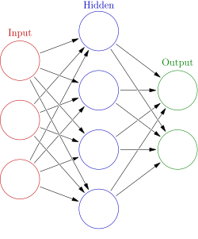
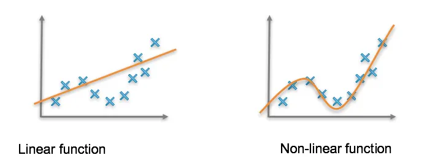
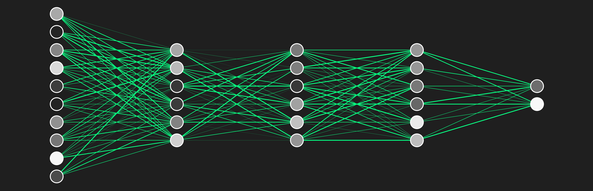

## Introduction
Artificial Intelligence (AI) is proving to be a an increasingly powerful tool, and some think that it is utterly inscrutable. 
However, I want to push back against that idea by teaching you about neural networks! 
Neural networks are the foundation of deep learning, so an understanding of neural networks can improve our understanding of AI!
In this blog, I aim to teach the fundamentals of the structure of neural networks, how they're trained, and give an example of neural networks running.

## Basic Structure

A neural network's goal is to iteratively create a function that maps existing input x's onto correct output y's such that we can accurately **predict** y's given new x's.

### Neurons

A neural network consists of a series of **neurons** (also called **nodes**) arranged in multiple interconnected layers, as shown in the above image.
A given neuron works by:

1. taking all of the previous inputs (`x1` through `xn`), 
2. multiplying them by a weight (`w1` through `wn`), 
3. summing them (`z`),
4. adding a "bias" (`b`) to `z`,
5. then passing it through a nonlinearity function (`𝜎`⁡) .

With all of that together, the math for a given neuron's activation `a` will look like this: (Note that `z` looks remarkably similar to a linear regression equation.)
$$
z = w_1x_1 + w_2x_2+...+w_nx_n+b,\space\space a=\sigma(z)
$$

The reason we pass `z` into a nonlinearity function is because nonlinear functions have some bend to them, which we can transform to make the model fit the shape of the data incredibly well.
If not for our nonlinearity function, a given neuron would only be able to produce a straight line and would miss out on a lot of higher level details. 

Commonly used functions are this are ReLUs (which has a bend from excluding negative values) and Sigmoids (which condenses inputs to be between 0 and 1)

### Layers in Neural Networks

A neural network functions by having every neuron in a given layer interact with every neuron in the next layer.
The first layer is called the "input layer," and will have a node for every input you pass into the neural network (inputs can range from various medical variables such as BMI and heart rate to pixels from an image).

From there, every input neuron will connect with every node in the next "hidden layer."
These nodes that aim to discover high-dimensional connections about the data though applying weights to the previous nodes' activations, then summing them with an added a bias.
Later on, the node's weights and bias will be tuned through training to more effectively recognize hidden connections within the data. 
From there, these nodes' activations will be passed into additional hidden layers until the final layer is reached.

Finally, after all of the neurons in the hidden layers activate, the neural network will return a value in the output layer. 
Sometimes this value will manifest as a probability between which of multiple outcomes will most likely be observed, or as a single number that predicts some metric (such as life expectancy). 
It's important to note that these are the model's best guesses, and not the objective truth.
This will give us the outputs that we'll test for accuracy in the training phase. 

## Training Process
### Analyzing Loss
Naturally, nobody will perfectly set up a neural network on the first try. 
The connections between nodes are incredibly numerous and dense, so someone looking at a neural network's connections could realistically only understand them as a black box.
However, you can mechanically optimize a neural network through a process called gradient descent, where you pay attention to the model's MSE (or some other loss function), then systematically adjust the linear combination of each node's weights in the direction that will reduce the MSE the most. 
After enough iterations, the loss should be significantly diminished!
$$
MSE = \text{mean}((w*x-y))^2
$$

### Training, Validation, and Testing
We train a neural network by splitting our existing training data into training, validation, and testing sets.
- The training set helps initialize node weights
- The validation set gives out of sample checkpoints
- The testing set is used at the end of training to test the network on 'brand new data'

This method of training is vital to make sure that the model is not overfit on the training data and will be capable of working with real data. 

## Example with MNIST Data
The MNIST database is a massive database that consists of tens of thousands of handwritten numbers in a 28x28 pixel resolution that each come with classifying labels.

This dataset is a classic for explaining the process of how neural networks function.

Since there are 784 pixels in a given 28x28 image, one would initialize the neural network with 784 neurons in the input layer. 
Additionally, since there are 10 numbers that the number could be, the neural network will have 10 output neurons that correspond to 0-9.
The person setting up the neural network would also divide the data into a training, validation, and testing set, then would begin the training process.

Each input layer node will accept a number between 0.00 and 1.0 that represents the pixel's grayscale as that input neuron's activation.

From there, those inputs will be passed into the first hidden layer (whose number of neurons will depend on how the neural network is set up).
Then, each node from the first hidden layer will act as the input for the next hidden layer, which will continue until the output layer is reached.
The output layer node with the highest activation will be what the network classifies the number as.

From there, the neural network will figure out the total MSE between the output neurons and their classified labels (which will be 0 for all outputs except the correct label), then do some gradient descent to adjust the weights, then will see how those changes affect the MSE of a different input from the training set.

Finally, after enough rounds of training and validation, the model will be run with the test set to see how accurate it is with brand new data.

## Conclusion
I hope this has given you a better idea of how neural networks function and that the parallels to deep learning are clear (predictive inference, data-based training process, etc.)
If you are interested in learning more, I'd recommend looking into training enhancements (like learning rates or dropout) or the math behind gradient descent!

